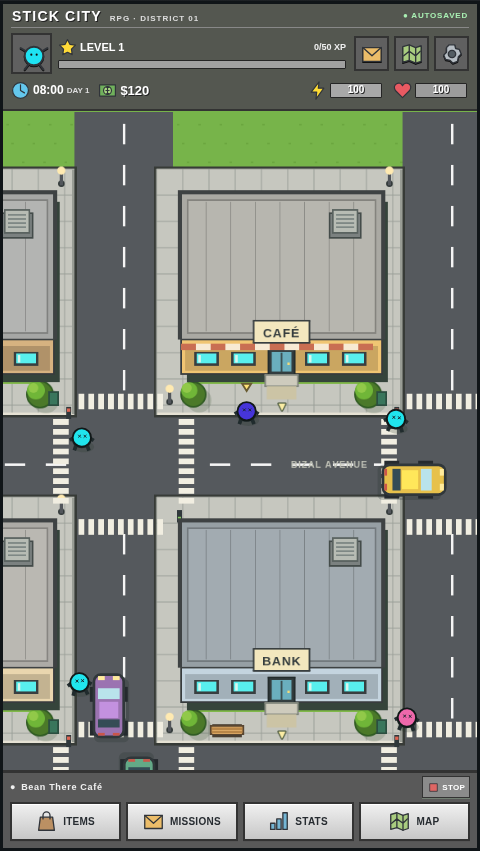
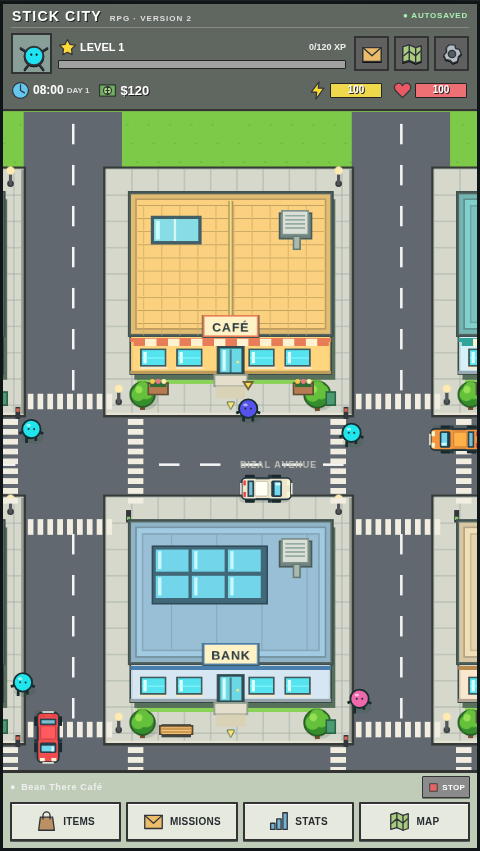

# Version 2 validation — 23 October 2026

## Completed checks

- Type checking and production build pass with the existing dependencies.
- 34 model/navigation/traffic tests pass. These cover XP curves and carry, incremental skills, the early-game pacing simulation and rate bounds, all job prerequisites, course costs and persistence, inventory and banking, missions/minigames, V1 migration and backup, pending-save restoration, developer isolation and import validation, safe walking routes and traffic. A quota-failure regression also verifies that inability to write a V1 backup cannot discard the readable original progress.
- Traffic is simulated for ten minutes with following-gap checks, several complete laps, oriented sprite-overlap checks and static-building exclusion. A stopped leader test verifies braking and subsequent resumption. Every vehicle completes at least three laps; overlap avoidance is not achieved by leaving the simulation stopped.
- The local V2 city and Developer Menu launch in Chromium without page errors. All 11 production-browser cases pass (1.5 minutes): walking/collision/camera, real timer progression and pending reloads, shopping/banking/Mayor missions, course-based job unlocks, developer state controls and safe noclip recovery, JSON import/export and reset confirmation, automatic V1 migration, slots/timing, simulation pause/resume, 320px/390px touch layouts, and an actual 1× versus 5× movement comparison. Long activity completions use a controlled clock in tests; the timer test also observes real elapsed progress. This is not a 74-minute human playthrough.

## Artwork comparison

The two requested listing URLs were checked again. AppStorio was accessible; AppsHunter returned HTTP 520 during the V2 request. The archived listing HTML and authentic developer promotional images retained from V1 research remain available. Original image `macrumors-0.jpg` and the V1 desktop capture were inspected before V2 art changes.

V2 retains the same district coordinates and overhead view. It adds warmer roof palettes, cyan skylights and façades, reusable tile/metal/glass roof archetypes, flower planters, brighter layered trees and grass, animated feet, outlined cars with dark windscreens and better proportions, and flatter retro buttons. The compact grey HUD remains. These are newly drawn assets, not pasted screenshots. Original oblique façades, exact scale and animation remain approximations.

## Browser and publication

Pending: commit/push, existing GitHub Pages deployment and a public-origin gameplay smoke check. The final build and focused JSON/migration browser regressions passed again after the storage-quota fix. Actual iPhone / Mobile Safari testing is not available in this environment and must not be described as verified.

## Before and after

The following captures were inspected directly. V2 is brighter and more detailed while retaining the same map and portrait composition.

| V1 | V2 |
| --- | --- |
|  |  |

Additional captures: [V2 phone](screenshots/v2-gameplay-phone.png), [Developer Menu](screenshots/v2-developer.png), [career requirements](screenshots/v2-careers.png).

## Remaining limits

- Level-5 pacing is a deterministic approximation; player choices and travel affect actual duration. There are no offline activity rewards.
- Legacy saves keep earned levels/skills even when they exceed new progression expectations.
- Healthcare currently has assistant and nurse roles; doctor and further tiers remain future data additions.
- The district layout remains temporary. Driving, property, stocks, major combat and new mission chains were deliberately excluded.
- Original façades and exact animation remain approximations, and real Mobile Safari is untested.
