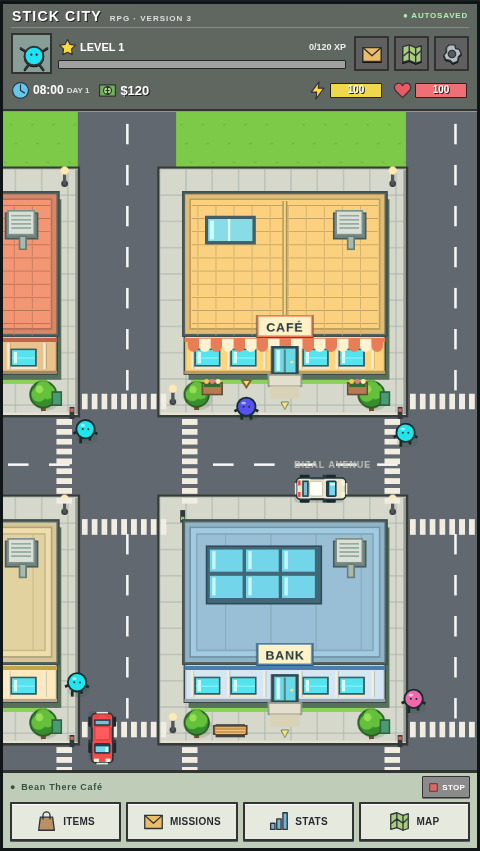

# V3 validation — 24 October 2026

## Local results

- 48 model/navigation/traffic/pursuit tests passed. These include synchronous transactions and zero scheduled reward timers; all 18 jobs and individual gates; 10 qualifications; five skills; equipment; mission objectives; V1/V2 migration and once-only V2 pending settlement; import validation; developer controls; police damage/defeat, cover and persistence; and ten minutes of traffic simulation.
- 16 production-browser cases passed in 1.9 minutes. They cover immediate repeated work/study/recovery, careers and qualifications, equipment/banking, new missions, actual NPC interaction/pickpocketing, Thieving training and high-tier robbery, armed police spawning and reload persistence, police take-down and clinic recovery, a real 30-second pursuit, developer/JSON controls, V2 migration, immediate slot/timing results and 320px/390px touch layout.
- The 30-second test uses explicitly enabled infinite health so it can measure the whole pursuit while proving police hits occur. A separate normal-health test proves police damage and take-down. This is not a claim that an idle normal player survives.
- A separate manual browser escape used ordinary health and movement, without resource cheats: 31.25 seconds elapsed, one escape, no defeat, health 100, no page errors. The route used normal pathfinding around the district.
- Type checking and production build passed. The final movement change also passed four focused browser regressions for walking/collision, NPC interaction, touch layout and stable menu scrolling.

## Delay audit

There is no active standard-action queue, scheduled completion, real-time activity progress bar or disabled slot-animation lock. `pending` is only read from legacy V2 records for migration. Remaining clocks belong to movement/traffic, interactive minigame input, police pursuit, non-blocking toast dismissal and releasing an export download URL. Normal transaction results are applied before the call returns and before any animation.

## Research and visuals

Original developer/AppStorio pages were retrieved successfully with a browser user-agent after initial upstream access errors. They confirm the original robbery/pickpocket loop and ten skills, but do not disclose an original Thieving probability/XP table. [Crime research](THIEVING_REFERENCE.md) distinguishes corroborated features from remake rules. Authentic developer screenshots retained from V1/V2 were revisited.

The map is unchanged. V3 adds police caps/projectiles, reusable façade piers and awning detail, a Thieving skill icon, readable wanted status, a career screen and detailed robbery cards. These remain original procedural assets with the compact retro interface. Real Mobile Safari remains untested.

| V2 | V3 |
| --- | --- |
|  |  |

Captures: [Thieving/robbery](screenshots/v3-thieving.png), [police pursuit](screenshots/v3-police-pursuit.png), [careers](screenshots/v3-careers.png), [phone](screenshots/v3-gameplay-phone.png), [developer controls](screenshots/v3-developer.png).

## Deployment

Code commit [`8153436`](https://github.com/charliegghaccount/stick-city-test/commit/8153436ffc45cbdbf1d348e880216baf0b99e111) is live at the unchanged [Pages URL](https://charliegghaccount.github.io/stick-city-test/). [Workflow 40058245755](https://github.com/charliegghaccount/stick-city-test/actions/runs/40058245755) passed all build/deploy jobs, including 48 rule tests and production typecheck/build.

The actual public-origin browser check verified HTTP 200 HTML/JS/CSS, V2 pending migration paid once, touch movement, developer teleport, two immediate job payments, ten qualifications, Thieving editing, armed police damage, wanted save/reload, modifier reset and portrait layout, with no page errors. Public responses were forwarded unmodified by the platform-CA-trusting Playwright request client because Chromium itself lacks the cloud proxy CA; no certificate bypass or local asset substitution was used. See [live screenshot](screenshots/v3-gameplay-live.png) and [deployment details](DEPLOYMENT.md).

## Scope and limits

- Robbery formulas/payouts and the requested 30-second pursuit are remake choices; exact original numerical fidelity is not claimed.
- Existing saved character/skill levels and earned assets are preserved. V2 paid pending actions settle once immediately instead of losing costs or waiting.
- Buildings may be alert for an amount of in-game time; ordinary instant work/rest advances that clock. This is not a hidden wall-clock action delay.
- Pursuit pauses in background tabs and persists through reload. Normal building actions cannot be used to become invulnerable; inventory healing is allowed.
- No permanent map rebuild, driving, property, stocks, native app conversion or broad combat system was added.
